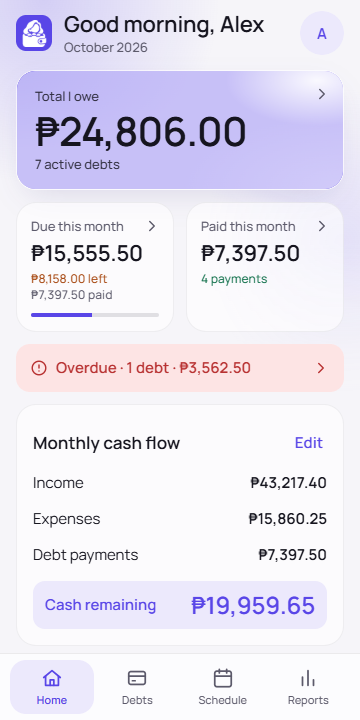
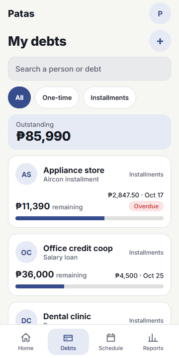
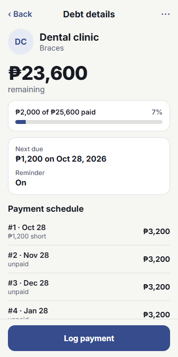
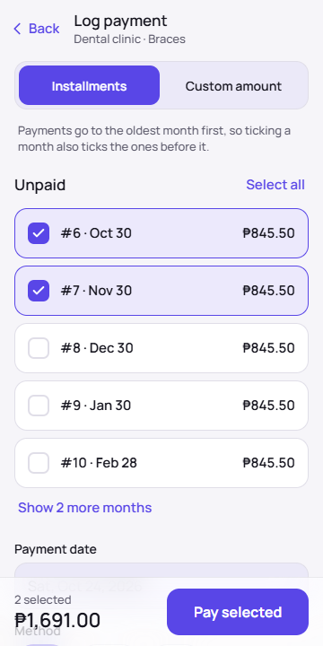
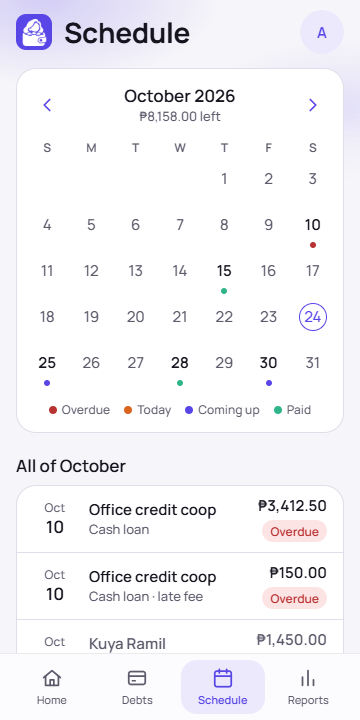
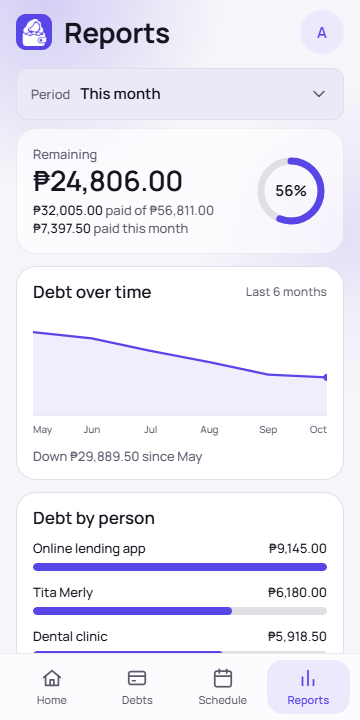
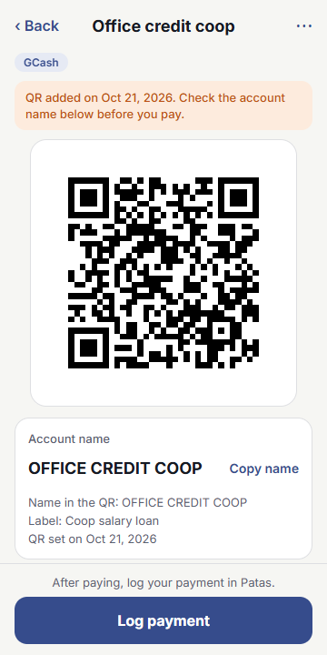
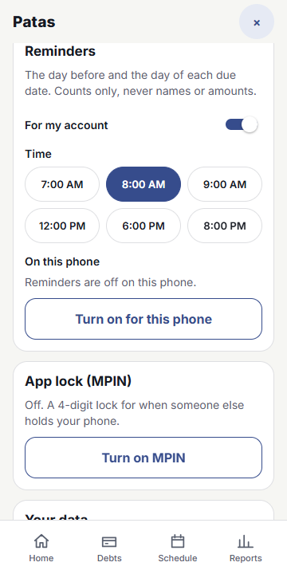
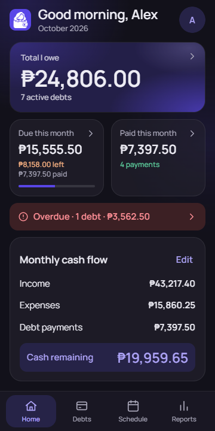
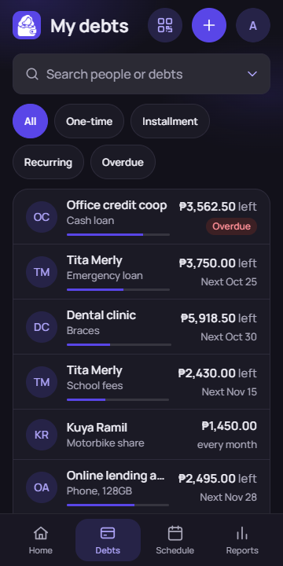

<div align="center">


# Patas

**Who you owe, what is left, and what is due next.**

A free debt and installment tracker for people in the Philippines. Put your GCash GGives, SLoan,
SPay Later, bank and salary loans, LTO or SSS/Pag-IBIG loans, and money borrowed from family or friends in one
place. It works offline, reminds you without naming anyone, and keeps your payment QR codes safe.

**[Open the live app →](https://patas-fawn.vercel.app)** · **[Download for Android (APK) →](https://github.com/MarkBasa96/patas/releases/latest/download/Patas-1.0.0.apk)**

<sub>iPhone: open the live app in Safari → Share → Add to Home Screen.</sub>

</div>

---

## Why it exists

Most people with a few loans keep the details in their head, a notes app, or old chat messages. Then a due date
slips, and a late fee shows up. Patas answers three questions and nothing else gets in the way:
**who do I owe, how much is left, and what is due next.**

The amount left is never something you type. It is worked out from the payments you log, so it can't drift.

Version 1 tracks debts **you owe**. It does not track money other people owe you.

## Features

- **Two kinds of debt.** *One-time*, with an optional pay-by date or "Pay when I can". *Installments*: an amount times a number of months from a start date, and Patas generates the due dates.
- **Log payments with the real amount.** Paid ₱2,000 of a ₱3,200 installment? It shows *partly paid, ₱1,200 short*. Paid extra? The overpayment rolls to the next installment. Paid late is marked.
- **Add charges by hand:** late fee, penalty, interest or other. Nothing is added automatically, so there is no surprise interest.
- **Settle with a write-off,** or reopen a debt later.
- **Home:** Total I owe, Due this month (and how much of it is paid), Paid this month, and Next payment.
- **Monthly cash flow card:** you type your income and expenses, and it shows the cash left after your debt payments.
- **Debts list** with search and filters, **Schedule** of upcoming payments by date, and **Reports** with CSV export and a shareable summary.
- **Payment QR gallery.** Save the QR codes you pay with (GCash, Maya, GoTyme, bank, other), link one to a debt, and tap **Pay** to show it full screen. It works offline after the first view.
- **Reminders:** one short phone notification the day before and the day of a due date, at a time you choose. It only says how many payments are due, never names or amounts. A **Send test reminder** button checks it works. You can turn it off per debt.
- **Optional app lock:** a 4-digit MPIN, off by default. Asked when the app opens and after 30 minutes away. Checked on the server; after 5 wrong tries you need an email code.
- **Sign in with a 6-digit email code.** No password to remember or leak. A bot check protects sign-in.
- **Works offline.** Saves land on your phone and sync when you're back online.
- **Backup and restore** to a file. **Delete my account** removes everything, including your QR files.
- **Light, dark or system,** and six colour themes (default Ink blue).
- Peso (₱) by default. You can change the currency symbol for display; there is no conversion. English only.

## Screenshots

| Home | Debts | Debt details | Log a payment |
|---|---|---|---|
|  |  |  |  |

| Schedule | Reports | Show QR to pay | Reminders (light) |
|---|---|---|---|
|  |  |  |  |

| Home (dark) | Debts (dark) |
|---|---|
|  |  |

<sub>Screenshots use invented sample data.</sub>

## Privacy

> Your debts and saved QR codes are private: other Patas users can't see them. I run this server and can
> technically access what is stored. I don't browse it; I would only look to fix a problem you report or
> where the law requires. It is never sold or used for ads. It is stored by Supabase (database and files)
> and served by Vercel; reminders reach your phone through its push service (Google, Apple, Mozilla or
> Microsoft), encrypted. Deleted items disappear from your lists at once and stay hidden on the server
> until you delete your account; "Delete my account" removes all your data and QR files.

This is the short version of the notice inside the app. Contact: joemarkudemy@gmail.com. You can also complain
to the [National Privacy Commission](https://privacy.gov.ph). If you run your own copy (below), you run your
own server and make your own privacy promise.

## How it was built

Designed and built by Joemark Basa, with Claude (an AI) as the engineer, and an AI security reviewer and an AI
design reviewer checking the work. Every feature is backed by tests: 83 app tests, 97 privacy checks, 67
reminder and MPIN checks, an end-to-end check of ten steps, and 59 deliberately planted bugs that the tests
had to catch (all 59 were caught).

## Tech stack

| | |
|---|---|
| App | [Expo](https://expo.dev) (React Native and web), TypeScript |
| Backend | [Supabase](https://supabase.com): Postgres with Row Level Security on every table, Auth, Storage, Edge Functions, pg_cron |
| Reminders | Web Push, written with WebCrypto and checked against RFC 8291 |
| Offline | PWA with an offline service worker |
| Hosting | Vercel; Android app as a Trusted Web Activity built with PWABuilder |

## Security notes

The full design is in `docs/SECURITY_DESIGN.md`. The strongest points, in plain words:

- **Your rows are yours.** Row Level Security is on every table, and tests prove another account gets nothing back, even calling the database directly.
- **Signed-out visitors get nothing.** No table can be read without signing in.
- **QR pictures sit in a private folder with no web links.** The app downloads your QR with your own login. The server refuses to create shareable links, even for your own files.
- **A QR can't be quietly swapped.** A saved QR's picture can't be changed in place. The app reads the payee name from inside the QR, warns for 14 days when a QR was changed, and refuses to show a QR that no longer matches what you saved. The server stamps the dates, so a phone can't fake them.
- **"Delete my account" runs on the server.** It removes your QR files first, then the account and every row.
- **Limits against abuse.** Per-account caps on rows and a 256 KB limit per QR file. The reminder sender only talks to real push services (Google, Apple, Mozilla, Microsoft), never an address a user types.
- **The MPIN is hashed with a secret pepper** and checked on the server, never in the app.

## Run it yourself

You need Node 22 and a free [Supabase](https://supabase.com) project.

```bash
cd app
npm install
cp .env.example .env.local
```

Fill in `.env.local` with `EXPO_PUBLIC_SUPABASE_URL`, `EXPO_PUBLIC_SUPABASE_PUBLISHABLE_KEY` and
`EXPO_PUBLIC_TURNSTILE_SITE_KEY`. These three are public by design. Never put the Supabase service key in them.

Then set up Supabase:

1. Run `supabase/schema.sql` in the Supabase SQL editor. It also makes the reminder schedule's secret and the MPIN pepper inside Supabase Vault, so you never paste a secret; the push keys are made by `send-reminders` on first use.
2. Deploy the Edge Functions in `supabase/functions/`. `send-reminders` is deployed with JWT verification off (see `supabase/config.toml`); first set `SUBJECT` in `send-reminders/index.ts` to your own site address.
3. Run `supabase/migrations/0006_reminder_cron.sql`, after editing the project URL inside it.
4. In Supabase Auth, enable sign-in with an email code and the Turnstile captcha. Your own SMTP is recommended: the built-in mailer is heavily rate-limited.

Commands (from `app/`):

```bash
npm run web          # dev server
npm run check        # type-check, lint and tests
npm run export:web   # web build
node scripts/write-sw.mjs dist   # writes the offline file list for that build
```

Privacy tests run against an in-memory Postgres, with no cloud needed: `cd supabase/test && npm install`, then from the
repository root `node supabase/test/run-local.mjs` (97 checks), `node supabase/test/run-6f.mjs` (67) and
`node supabase/test/mutants.mjs` (59 planted bugs).

## Licence

MIT © 2026 Joemark Basa
